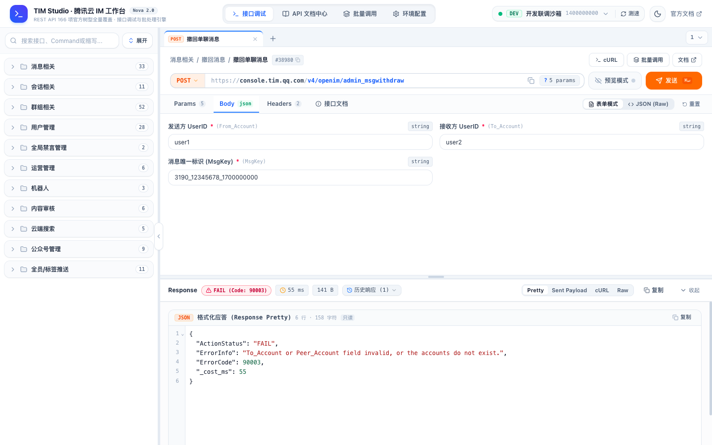
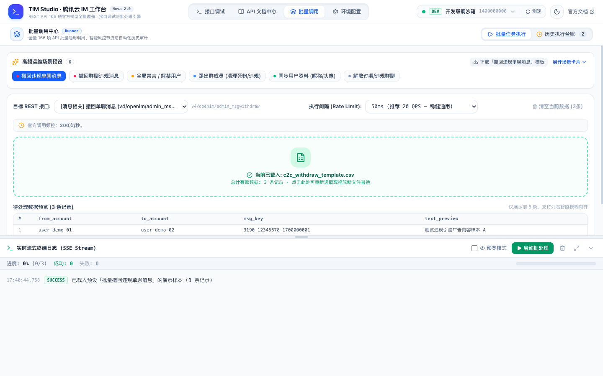
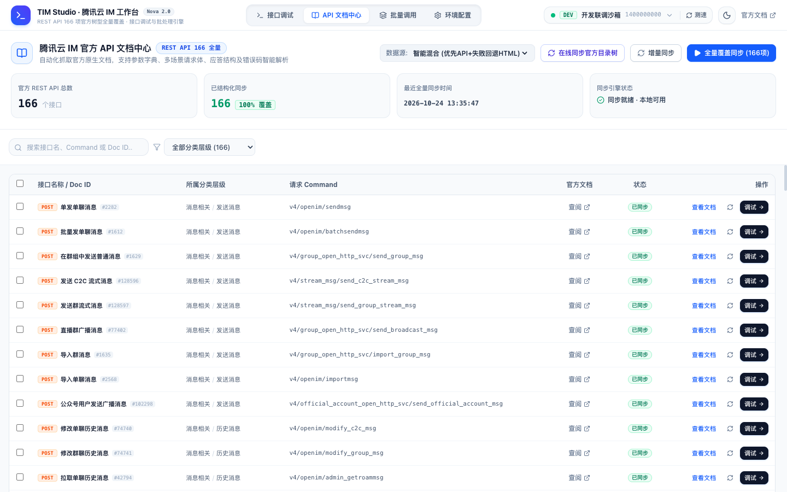
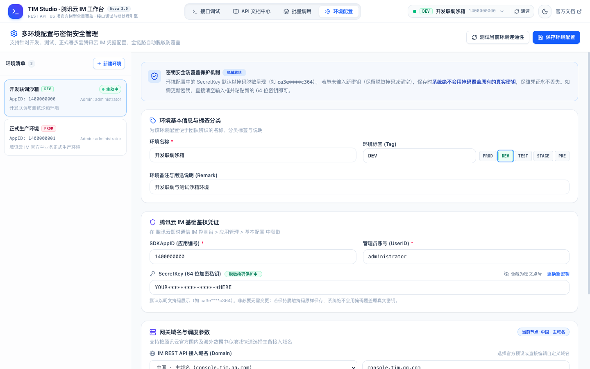

<div align="center">

# 🚀 TIM Studio (Nova)

**腾讯云即时通信 IM 全功能可视化管理控制台**

*A modern, full-featured developer & DevOps visual management studio for Tencent Cloud IM.*

[](LICENSE)
[](https://www.python.org/)
[](https://fastapi.tiangolo.com/)
[](https://react.dev/)
[](https://tailwindcss.com/)
[](https://cloud.tencent.com/document/product/269/1520)

<br/>



</div>

---

## 📖 项目简介

**TIM Studio (Nova)** 是专为腾讯云即时通信 IM（Tencent Cloud IM）打造的一站式现代化可视化调试、运维管理与批处理平台。

传统研发与运维在操作腾讯云 IM 时，往往面临 UserSig 签名繁琐、Postman 重复配置、官方 166 个 REST API 参数各异、批量撤回/推送缺乏自动化工具等痛点。TIM Studio 彻底告别零散脚本与繁琐鉴权，提供开箱即用的浏览器端 IDE 级管理体验：

- ⚡ **原生内置前端**：打包产物已预编译至 `static/` 目录，**普通用户仅需 Python 3.8+ 即可一键启动**，无需安装 Node.js 或 pnpm。
- 🛡️ **安全隔离**：完全私有化本地运行，凭据与密钥从不外发第三方；前端展示全链路自动脱敏防覆盖。
- 📱 **全端响应式**：完美自适应宽屏显示器、笔记本分屏、平板及手机移动端（内置移动端底栏导航与侧边抽屉）。

---

## ✨ 核心特性

### 1. 🎯 全量 166 项 REST API 原生覆盖
- 涵盖腾讯云 IM 官方全部 11 大业务板块：
  - **消息相关**（单发/批量发单聊消息、撤回单聊消息、设置已读等）
  - **群组相关**（创建/解散群组、群成员管理、群消息撤回/禁言、加群审批等）
  - **用户与资料管理**（账号导入、资料设置/拉取、黑名单、在线状态查询等）
  - **会话相关**（拉取最近会话、删除会话、消息置顶等）
  - **全局禁言管理**（设置/查询单聊与群聊全局禁言）
  - **运营与全员推送**（全员广播、标签推送、应用属性管理等）
  - **机器人管理**、**内容审核**、**公众号管理**、**云端搜索**等。
- 目录层级、中英文名、Command 路由及文档 DocID 严格对齐腾讯云官方最新规范。

### 2. 🧪 Postman 级接口调试工作台 (Workbench)
- **多标签页工作流**：支持同时打开多个接口独立调试，随时新建、关闭、一键还原。
- **双向无缝转换**：支持友好**表单模式（Form）**与**专业 JSON 模式**实时双向解析同步，字段类型自适应校验。
- **智能预设与官方示例**：内置官方场景入参示例，点击即可一键载入至请求体。
- **自动签名与参数组装**：内置高速内存缓存版 `TLSSigAPIv2`（UserSig 生成器），自动生成标准 Query 参数与完整 cURL 调用命令。
- **预览模式（Dry-Run）**：开启后仅执行入参校验与请求报文结构生成，不向腾讯云发起真实网络写入，防止生产误操作。
- **调用历史对账**：每个接口独立记录本地调用历史与完整回执，刷新页面默认持久化保留。

---

### 3. 🚀 批量调用中心 (Runner) 与审计台账



- **高频场景预设**：开箱即用内置批量撤回违规单聊消息、批量撤回群违规消息、批量禁言违规用户、批量导入账号、全员广播推送等模板。
- **表格无缝导入导出**：支持 CSV / Excel（.xlsx）批量数据拖拽解析，支持一键下载标准 CSV 模板（UTF-8 BOM 编码，Excel 双击打开无乱码）。
- **智能风控与频率限制**：系统自动结合官方文档频控规则，动态推荐与限制最小执行间隔（如 20 QPS / 5 QPS），防止触发腾讯云控制台风控封停。
- **流式终端监控**：执行过程支持实时暂停、继续、强制终止，日志流式输出并统计成功率与耗时。

<br/>


- **失败重试与历史台账**：单键重试失败项，所有批次调用自动持久化归档至审计台账，支持全量与失败项独立导出。

---

### 4. 📚 原生级官方文档中心 (Doc Center)



- **离线全量文档**：内置全量 166 项 API 结构化文档与错误码字典，离线环境亦可快速查阅。
- **在线同步引擎**：支持直接在线同步腾讯云官方目录树与最新文档正文，支持动态接口与静态 HTML 两种抓取模式，热重载生效。
- **一键直达沙箱**：在文档中心查阅任意接口时，可一键将其装载到调试工作台中直接发起测试。

---

### 5. 🌐 多环境与密钥安全管理 (Settings)



- **多套凭据隔离**：支持配置多套环境（如 PROD 生产环境、DEV 开发沙箱、TEST 测试等），支持打标、备注与一键平滑切换。
- **全球 8 大地域支持**：内置官方中国、新加坡、首尔、东京、法兰克福、硅谷、雅加达、利雅得主备域名映射。
- **防覆盖保护与脱敏**：前端展示时密钥自动前4后4星号脱敏；提交更新时即便携带掩码亦不会覆盖后台真实密钥。
- **一键连通性测试**：一键检测当前环境鉴权配置、网络延迟与腾讯云连通性。

---

### 6. 📱 全视口响应式设计 (Mobile & Split-Screen)

<div align="center">
  
</div>

- **分屏与移动端原生体验**：在屏幕宽度小于 768px 时自动激活原生风格的**底部导航栏**与**侧边抽屉**。
- **单手自适应**：接口调试、文档查阅、批处理控制台均可在手机与平板设备上顺畅触控操作。

---

## 📂 项目结构

```text
.
├── apis/                   # 10+ 核心业务领域模块 Python 实现 (Account, Group, Msg 等)
├── core/                   # 核心支撑引擎
│   ├── config.py           # 多环境配置管理、密钥脱敏与存储
│   ├── registry.py         # 166 个 REST API 元数据注册表
│   ├── sig_util.py         # 腾讯云 TLSSigAPIv2 (UserSig) 算法与内存缓存
│   ├── tim_client.py       # 通用 HTTP 调用客户端
│   ├── tim_full_catalog.json # 官方全量 166 REST API 标准元数据库
│   ├── batch_presets.py    # 批量运维预设场景模版与 QPS 风控规则
│   ├── task_runner.py      # 批处理执行器与审计台账
│   ├── doc_syncer.py       # 官方文档抓取与解析引擎
│   └── tree_syncer.py      # 官方目录树在线同步引擎
├── docs/                   # 项目文档与展示资源
│   └── images/             # 高清脱敏界面截图 (WebP / 压缩 PNG)
├── scripts/                # 运维工具与离线维护脚本
│   ├── run_withdraw.py     # 独立单聊消息批量撤回命令行工具 (CLI)
│   ├── build_full_tim_catalog.py # 目录元数据离线重构工具
│   └── full_rest_pages.json      # 页面基础索引源
├── static/                 # 前端发布产物 (已编译，无需 Node.js)
│   ├── index.html
│   ├── favicon.svg
│   └── assets/             # 压缩后的极轻 JS/CSS 单包
├── storage/                # 本地持久化数据
│   ├── docs/               # 官方全量 166 API 离线结构化文档库 (JSON)
│   └── official_live_tree.json # 官方在线同步目录树缓存
├── tests/                  # 自动化单元测试套件 (pytest)
│   └── test_studio.py
├── web/                    # 前端源代码 (React 19 + Tailwind v4 + Vite)
│   ├── src/                # 现代化组件、状态管理 (Zustand) 与面板
│   ├── package.json
│   └── vite.config.ts
├── app.py                  # FastAPI 后端服务主入口
├── config.example.json     # 配置文件模板 (含多环境示例)
├── requirements.txt        # Python 依赖清单
├── LICENSE                 # 开源许可协议 (MIT)
└── README.md
```

---

## 🚀 极速上手

### 运行环境准备
- **操作系统**：macOS / Linux / Windows
- **Python 版本**：Python 3.8 或更高版本

### 1. 安装后端依赖

```bash
# 克隆仓库
git clone git@github.com:junit/tim-studio.git
cd tim-studio

# 安装依赖
pip install -r requirements.txt
```

### 2. 准备配置文件

复制模板生成 `config.json`，并填入您的腾讯云 IM 凭据（可从 [腾讯云 IM 控制台](https://console.cloud.tencent.com/im) 获取）：

```bash
cp config.example.json config.json
```

编辑 `config.json`：
```json
{
  "active_env_id": "env_dev",
  "environments": [
    {
      "id": "env_dev",
      "name": "开发联调沙箱",
      "tag": "DEV",
      "remark": "开发联调与测试沙箱环境",
      "sdkappid": 1400000000,
      "secret_key": "YOUR_DEV_SECRET_KEY_HERE",
      "admin_user": "administrator",
      "domain": "console.tim.qq.com",
      "delay_sec": 0.05
    }
  ]
}
```

> 💡 **提示**：您也可以先不修改 `config.json`，直接启动服务后，在网页的 **「环境配置」** 页面中直接可视化添加与测试环境！

### 3. 启动服务

```bash
python3 app.py
```

服务启动后，在浏览器中打开：
👉 **http://127.0.0.1:8000**

---

## 💻 前端二次开发 (可选)

如果您需要修改 UI 样式或开发新面板，可进入 `web/` 目录运行 Vite 开发服务器：

```bash
cd web

# 安装依赖 (推荐使用 pnpm)
pnpm install

# 启动热重载开发服务器 (默认端口 5173，自动反向代理到 8000 端口)
pnpm run dev
```

构建前端并自动同步至 `static/` 生产目录：
```bash
pnpm run build
```

---

## 🔒 安全与隐私保障

1. **零第三方网络依赖**：除向腾讯云官方 API 域名（如 `console.tim.qq.com`）发起您主动调试的请求外，TIM Studio 不向任何第三方服务器发送用户数据或凭据。
2. **密钥全链路脱敏**：控制台接口返回的密钥全部经过掩码脱敏处理，防止屏幕截屏或分享时泄露核心 Key。
3. **本地离线审计**：批量执行的明细台账、请求日志全部保存在本地 `storage/` 目录中，随时可在页面上一键彻底清空。

---

## 🤝 参与贡献

欢迎提交 Issue 和 Pull Request！
1. Fork 本项目
2. 创建您的特性分支 (`git checkout -b feature/AmazingFeature`)
3. 提交您的修改 (`git commit -m 'Add some AmazingFeature'`)
4. 推送分支 (`git push origin feature/AmazingFeature`)
5. 新建 Pull Request

---

## 📄 开源许可证

本项目采用 **MIT License** 许可证，允许自由商业使用、修改与分发。详见 [LICENSE](LICENSE)。
