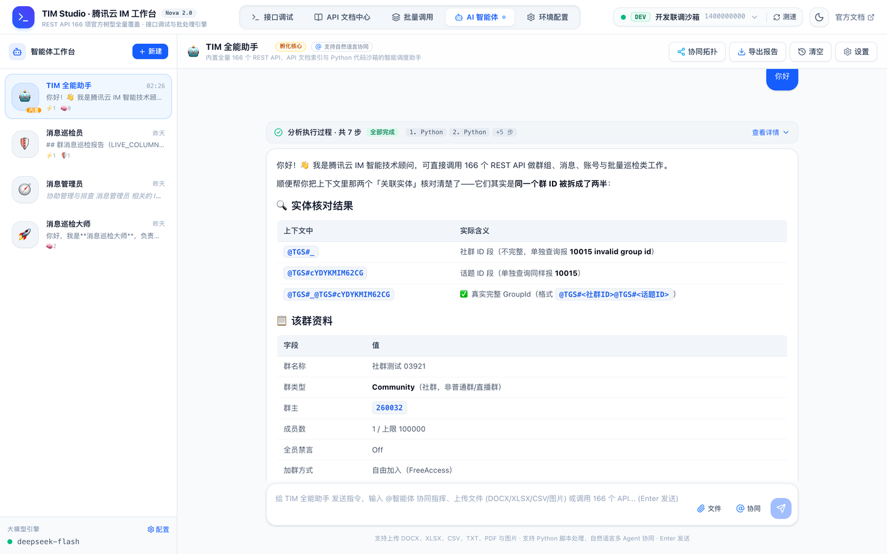
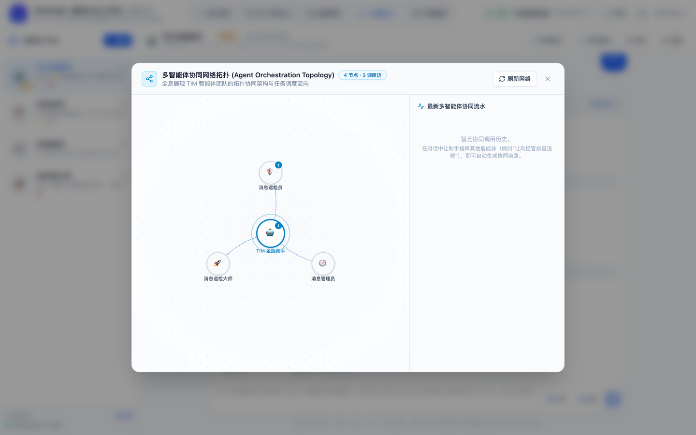

<div align="center">

# 🚀 TIM Studio (Nova)

**腾讯云即时通信 IM 全功能可视化管理控制台 · 接口调试 · 批量运维 · 进化型 CodeAgent 智能体**

*A modern, full-featured developer & DevOps visual management studio with Evolving CodeAgents for Tencent Cloud IM.*

[](LICENSE)
[](https://www.python.org/)
[](https://fastapi.tiangolo.com/)
[](https://react.dev/)
[](https://tailwindcss.com/)
[](https://cloud.tencent.com/document/product/269/1520)

<br/>


</div>

---

## 📖 项目简介

**TIM Studio (Nova)** 是专为腾讯云即时通信 IM（Tencent Cloud IM）打造的一站式现代化可视化调试、自动化批处理与**具备自我进化能力的多智能体协同运维平台**。

传统研发与运维在操作腾讯云 IM 时，往往面临 UserSig 签名繁琐、Postman 重复配置、官方 166 个 REST API 参数各异、批量撤回/推送缺乏自动化工具，以及突发排障全靠人肉翻文档等痛点。TIM Studio 彻底告别零散脚本与繁琐鉴权，提供开箱即用的浏览器端 IDE 级管理体验：

- ⚡ **开箱即用，免配 Node 环境**：前端打包产物已深度预编译并内置至 `static/` 目录，**普通用户仅需 Python 3.8+ 即可一键启动**，无需安装 Node.js、pnpm 或配置前端代理。
- 🛡️ **安全隔离与高危保护**：完全私有化本地运行，凭据与密钥不外发第三方；针对解散群组、注销账号等敏感操作内置**人机协同安全门禁 (Consent Gate)**。
- 🤖 **进化型 CodeAgent**：基于代码即动作（Code-as-Action）理念，智能体直接编写并沙箱执行 Python 脚本编排 166 个 API，具备提示词自增强、技能自沉淀、企业知识库挂载与多 Agent 拓扑协同能力。
- 📱 **全端视口智能响应**：完美自适应宽屏显示器、笔记本分屏、平板及手机移动端（窄屏自动启用 Overlay 浮层抽屉，移动端配备微信级滑出抽屉与底栏导航）。

---

## ✨ 核心特性

### 1. 🎯 全量 166 项 REST API 原生覆盖
- 涵盖腾讯云 IM 官方全部 11 大业务板块：
  - **消息相关**（单发/批量发单聊消息、撤回单聊消息、设置已读、查询历史消息等）
  - **群组相关**（创建/解散群组、群成员管理、群消息撤回/禁言、加群审批等）
  - **用户与资料管理**（账号导入、资料设置/拉取、黑名单、在线状态查询等）
  - **会话相关**（拉取最近会话、删除会话、消息置顶等）
  - **全局禁言管理**（设置/查询单聊与群聊全局禁言）
  - **运营与全员推送**（全员广播、标签推送、应用属性管理等）
  - **机器人管理**、**内容审核**、**公众号管理**、**云端搜索**等。
- 目录层级、中英文名、Command 路由及文档 DocID 严格对齐腾讯云官方最新规范。

---

### 2. 🧪 Postman 级接口调试工作台 (Workbench)
- **多标签页与状态持久化**：支持同时打开多个接口独立调试；标签页、表单参数草稿与激活状态**自动在本地持久化记忆**，刷新页面或切换菜单不丢失上下文。
- **高频与最近打开智能推荐**：暂无打开标签页时，系统自动聚合展示高频常用接口与最近调试记录，告别手动层层翻找目录树。
- **双向无缝转换**：支持友好**表单模式（Form）**与**专业 JSON 模式**实时双向解析同步，字段类型自适应校验。
- **智能预设与官方示例**：内置官方场景入参示例，点击即可一键载入至请求体。
- **自动签名与参数组装**：内置高速内存缓存版 `TLSSigAPIv2`（UserSig 生成器），自动生成标准 Query 参数与完整 cURL 调用命令。
- **预览模式（Dry-Run）**：开启后仅执行入参校验与请求报文结构生成，不向腾讯云发起真实网络写入，防止生产误操作。
- **调用历史对账**：每个接口独立记录本地调用历史与完整回执，支持一键清空与回放。

---

### 3. 🚀 批量调用中心 (Runner) 与审计台账


- **高频场景预设**：开箱即用内置批量撤回违规单聊消息、批量撤回群违规消息、批量禁言违规用户、批量导入账号、全员广播推送等模板。
- **表格无缝导入导出**：支持 CSV / Excel（.xlsx）批量数据拖拽解析，支持一键下载标准 CSV 模板（UTF-8 BOM 编码，Excel 双击打开无乱码）。
- **智能风控与频率限制**：系统自动结合官方文档频控规则，动态推荐与限制最小执行间隔（如 20 QPS / 5 QPS），防止触发腾讯云控制台风控封停。
- **流式终端监控**：执行过程支持实时暂停、继续、强制终止，日志流式输出并统计成功率与耗时。

<br/>


- **失败重试与历史台账**：单键重试失败项，所有批次调用自动持久化归档至审计台账，支持全量与失败项独立导出。

---

### 4. 🤖 进化型 AI 智能体工作台 (CodeAgent & Multi-Agent Swarm)



TIM Studio 的智能体并非传统仅能打字聊天的对话机器人，而是**以代码为动作语言、具备自我进化与团队协作能力的专业 IM 运维工程师**：

- **以代码为动作语言（CodeAgent）**：
  基于 Hugging Face 开源 `smolagents` 思想架构，智能体直接编写并沙箱执行 Python 脚本来驱动腾讯云 IM 166 个 REST 接口。相比传统固定 JSON Tool Calling，在多接口串接、条件分支判断与高频批量循环上具备压倒性灵活性与确定性。
- **🛡️ 高危操作人机协同门禁（Human-in-the-Loop Consent Gate）**：
  当智能体在沙箱代码中调用解散群组（`destroy_group`）、批量注销账号（`account_delete`）、全局禁言（`forbid_send_msg`）、群消息全局撤回等高危操作时，沙箱即时挂起执行并实时流式推送至前端。UI 弹出高危授权确认卡片，展示涉及接口、风险等级、入参预览。用户可点击【批准执行】或【拒绝拦截】，从根源杜绝模型幻觉导致的不可逆灾难。
- **📖 轻量企业私有知识库挂载（RAG 检索增强）**：
  支持为各个独立智能体上传并挂载专属企业私有知识库（支持 Markdown、TXT、JSON、Word、Excel/CSV），提供轻量分块语义索引与上下文召回，支持在线测试检索与单文档独立启停，让智能体具备深厚业务私域知识。
- **🕸️ 多智能体协同网络与拓扑流转视图（Multi-Agent Swarm & Visual Topology）**：
  支持通过 `@` 呼叫或直接在自然语言对话中调度跨领域智能体（如让通用助手调度社群风控官），任务自动转派协同；提供交互式多智能体协同网络拓扑流转全景图，直观展现多 BOT 之间的调度拓扑与交互链路。

<br/>



- **📊 数据即地可视化分析（ECharts In-Chat Charting）**：
  智能体执行 Python 统计与业务分析代码时，可将群组成员分布、消息调用趋势、告警比例等数据就地渲染为交互式折线图、柱状图、饼图，可视化辅助运维决策。
- **📑 会话排障记录一键导出（Chat Export）**：
  支持将复杂的排障过程、执行的 Python 代码片段、控制台 Stdout、接口回执与可视化图表，一键导出为纯净的 **Markdown (.md)** 文档或脱敏自包含 **HTML 复盘报告**，便于团队运维归档与故障复盘。
- **🔌 模型服务一键探测与自定义（Model Auto-Discovery）**：
  支持一键动态探测后端 Base URL 下的 `/models`、`/v1/models` 以及 Ollama `/api/tags` 模型列表，支持快速点击切换及自由自定义，零门槛接入本地与公网私有大模型。
- **提示词自我增强（Prompt Self-Enhancement）**：
  BOT 可根据用户在交互过程中的要求（如*“禁言操作默认按 3600 秒执行”*），自主提炼并强化自身的 System Prompt 行为准则，实现经验的自动进化。
- **技能自沉淀（Self-Evolving Skills）**：
  BOT 现场验证通过的代码片段可被一键或自主沉淀为模块化 Python 技能脚本，随时复用。
- **全主流大模型兼容**：
  无缝直连 **DeepSeek (V3/R1)**、**通义千问 (Qwen-2.5)**、**本地内网 Ollama (零成本私有化运行)**、以及任何符合 OpenAI 规范的 API 接口。

---

### 5. 📚 原生级官方文档中心 (Doc Center)


- **离线全量文档**：内置全量 166 项 API 结构化文档与错误码字典，离线环境亦可快速查阅。
- **在线同步引擎**：支持直接在线同步腾讯云官方目录树与最新文档正文，支持动态接口与静态 HTML 两种抓取模式，热重载生效。
- **一键直达沙箱**：在文档中心查阅任意接口时，可一键将其装载到调试工作台中直接发起测试。

---

### 6. 🌐 多环境与密钥安全管理 (Settings)


- **多套凭据隔离**：支持配置多套环境（如 PROD 生产环境、DEV 开发沙箱、TEST 测试等），支持打标、备注与一键平滑切换。
- **全球 8 大地域支持**：内置官方中国、新加坡、首尔、东京、法兰克福、硅谷、雅加达、利雅得主备域名映射。
- **防覆盖保护与脱敏**：前端展示时密钥自动前4后4星号脱敏；提交更新时即便携带掩码亦不会覆盖后台真实密钥。
- **一键连通性测试**：一键检测当前环境鉴权配置、网络延迟与腾讯云连通性。

---

### 7. 📱 全视口响应式设计 (Mobile & Split-Screen)

<div align="center">
  
</div>

- **智能悬浮抽屉（Overlay Drawer）**：在屏幕宽度小于 1440px 或笔记本分屏下，智能体右侧资产与设置抽屉自动升级为带毛玻璃遮罩的悬浮滑出层，彻底杜绝主会话窗挤压变形与横向滚动条。
- **移动端原生级体验**：在屏幕宽度小于 768px 时自动激活原生风格的**底部导航栏**、**顶栏汉堡菜单**与**微信级侧边滑出抽屉**。
- **触控优化**：接口调试、文档查阅、批处理控制台均可在手机与平板设备上顺畅触控操作。

---

## 📂 项目结构

```text
.
├── apis/                   # 业务领域 API 模块 (Account, Group, Msg, Agent 等)
│   └── agent.py            # 智能体引擎、多 BOT 调度、RAG 与门禁审批 REST/SSE 路由
├── core/                   # 核心支撑引擎
│   ├── agent/              # 智能体架构实现
│   │   ├── engine.py       # CodeAgent 沙箱执行引擎与 smolagents 封装
│   │   ├── bot_manager.py  # 多 BOT 实例、人设准则、技能树与记忆持久化
│   │   ├── run_manager.py  # 异步运行实例与高危门禁拦截控制器
│   │   ├── rag_manager.py  # 轻量私有知识库挂载与语义检索召回管理器
│   │   ├── tools.py        # 166 个 REST API 调用工具与 Python 沙箱内建函数
│   │   └── constants.py    # 预设角色模版、高危 API 规则与系统提示词
│   ├── config.py           # 多环境配置管理、密钥脱敏与存储
│   ├── registry.py         # 166 个 REST API 元数据注册表
│   ├── sig_util.py         # 腾讯云 TLSSigAPIv2 (UserSig) 算法与高速内存缓存
│   ├── tim_client.py       # 通用 HTTP 调用客户端
│   ├── tim_full_catalog.json # 官方全量 166 REST API 标准元数据库
│   ├── batch_presets.py    # 批量运维预设场景模版与 QPS 风控规则
│   ├── task_runner.py      # 批处理执行器与审计台账
│   ├── doc_syncer.py       # 官方文档抓取与解析引擎
│   └── tree_syncer.py      # 官方目录树在线同步引擎
├── data/                   # 智能体本地持久化资产库
│   ├── bots.json           # 智能体角色与元数据配置
│   ├── knowledge/          # 企业私有知识库挂载文档与索引库
│   ├── skills/             # 智能体自我沉淀生成的 Python 技能脚本
│   └── memories/           # 智能体长期持久化事实记忆
├── docs/                   # 项目文档与展示资源
│   └── images/             # 高清脱敏界面截图 (WebP / 压缩 PNG)
├── scripts/                # 运维工具与离线维护脚本
│   ├── run_withdraw.py     # 独立单聊消息批量撤回命令行工具 (CLI)
│   ├── build_full_tim_catalog.py # 目录元数据离线重构工具
│   └── full_rest_pages.json      # 页面基础索引源
├── static/                 # 前端发布产物 (已构建单包，普通运行无需 Node.js)
│   ├── index.html
│   ├── favicon.svg
│   └── assets/             # 编译后的极轻 JS/CSS 单包
├── storage/                # 本地持久化数据
│   ├── docs/               # 官方全量 166 API 离线结构化文档库 (JSON)
│   ├── history/            # 批处理执行日志与历史审计台账
│   └── official_live_tree.json # 官方在线同步目录树缓存
├── tests/                  # 自动化单元测试套件 (pytest)
│   ├── test_studio.py      # 基础功能与接口工作台测试
│   └── test_agent.py       # 智能体、门禁、知识库与多 BOT 测试
├── web/                    # 前端源代码 (React 19 + Tailwind v4 + Vite + Zustand)
│   ├── src/                # 现代化组件与面板
│   ├── package.json
│   └── vite.config.ts
├── app.py                  # FastAPI 后端服务主入口
├── config.example.json     # 配置文件模板 (含多环境示例)
├── requirements.txt        # Python 依赖清单
├── LICENSE                 # 开源许可协议 (MIT)
└── README.md
```

---

## 🚀 极速上手

### 运行环境准备
- **操作系统**：macOS / Linux / Windows
- **Python 版本**：Python 3.8 或更高版本

### 1. 安装后端依赖

```bash
# 克隆仓库
git clone git@github.com:junit/tim-studio.git
cd tim-studio

# 安装依赖
pip install -r requirements.txt
```

### 2. 准备配置文件

复制模板生成 `config.json`，并填入您的腾讯云 IM 凭据（可从 [腾讯云 IM 控制台](https://console.cloud.tencent.com/im) 获取）：

```bash
cp config.example.json config.json
```

编辑 `config.json`：
```json
{
  "active_env_id": "env_dev",
  "environments": [
    {
      "id": "env_dev",
      "name": "开发联调沙箱",
      "tag": "DEV",
      "remark": "开发联调与测试沙箱环境",
      "sdkappid": 1400000000,
      "secret_key": "YOUR_DEV_SECRET_KEY_HERE",
      "admin_user": "administrator",
      "domain": "console.tim.qq.com",
      "delay_sec": 0.05
    }
  ]
}
```

> 💡 **提示**：您也可以先不修改 `config.json`，直接启动服务后，在网页的 **「环境配置」** 页面中直接可视化添加与测试环境！

### 3. 启动服务

```bash
python3 app.py
```

服务启动后，在浏览器中打开：
👉 **http://127.0.0.1:8000**

---

## 🤖 智能体大模型配置 (可选)

如需使用 **AI 智能体工作台**，只需在界面左侧点击 **「大模型引擎 - 配置」** 或在 `data/llm_config.json` 中配置即可：

- **DeepSeek 官方 API**：
  - 接口地址：`https://api.deepseek.com`
  - 模型标识：`deepseek-chat` 或 `deepseek-reasoner`
  - 填入您的 DeepSeek API Key。
- **本地 Ollama（100% 本地私有化，零成本）**：
  - 启动本地 Ollama（如运行 `ollama run qwen2.5:7b`）
  - 接口地址：`http://localhost:11434/v1`
  - 点击「探测模型」即可一键选定本地模型。
- **通义千问 / OpenAI / vLLM / 兼容服务**：
  - 填入对应 Base URL、API Key 与 Model Name 即可，支持点击动态探测下拉列表一键匹配。

---

## 💻 前端二次开发 (可选)

如果您需要修改 UI 样式或二次开发前端组件，可进入 `web/` 目录运行 Vite 开发服务器：

```bash
cd web

# 安装依赖 (推荐使用 pnpm)
pnpm install

# 启动热重载开发服务器 (默认端口 5173，自动反向代理到 8000 端口)
pnpm run dev
```

构建前端并自动同步至 `static/` 生产目录：
```bash
pnpm run build
```

---

## 🔒 安全与隐私保障

1. **零第三方网络依赖**：除向腾讯云官方 API 域名（如 `console.tim.qq.com`）发起您主动调试的请求外，TIM Studio 不向任何第三方服务器发送用户数据或凭据。
2. **高危人机协同门禁**：对解散群、删除账号、全员禁言等重大破坏性 API 实施沙箱拦截与人机确认，严防模型幻觉造成线上事故。
3. **密钥全链路脱敏**：控制台接口返回的密钥全部经过掩码脱敏处理，防止屏幕截屏或分享时泄露核心 Key。
4. **本地离线审计**：批量执行的明细台账、请求日志全部保存在本地 `storage/` 与 `data/` 目录中，随时可在页面上一键彻底清空。

---

## 🤝 参与贡献

欢迎提交 Issue 和 Pull Request！
1. Fork 本项目
2. 创建您的特性分支 (`git checkout -b feature/AmazingFeature`)
3. 提交您的修改 (`git commit -m 'Add some AmazingFeature'`)
4. 推送分支 (`git push origin feature/AmazingFeature`)
5. 新建 Pull Request

---

## 📄 开源许可证

本项目采用 **MIT License** 许可证，允许自由商业使用、修改与分发。详见 [LICENSE](LICENSE)。
